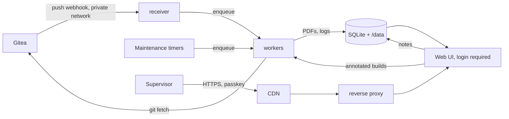

# Typst Review Server — Implementation Brief

Oct 20, 2026 · @Ben

## Problem and context

Build a small self-hosted web app that turns every push to a Typst thesis repository into a PDF, and shows supervisors what changed between versions.

- The author writes the thesis in Typst locally and pushes to one Git repository on the self-hosted Gitea (`git.benmandrew.com`).
- Supervisors review the thesis and add notes. Some annotate the PDF. Others prefer margin notes placed in the source, as they would write with LaTeX's todonotes package on Overleaf. They should not need Git, a Typst install or a typst.app account. They log in to this service with a passkey and never set a password.
- typst.app can sync with Git only on its paid Pro plan, and the self-hosted collaborative Typst editors we looked at (Collabst, TOSS, typst-web, TINO) do not combine Git with review comments. So we keep plain Git as the source of truth and add a build-and-diff service beside it.
- What supervisors need most is "what changed since I last read it", not a diff for every commit. Per-commit PDFs exist for history and for ad-hoc comparisons.

## Solution overview and non-goals

One service, one container, one repository: it receives push webhooks from Gitea, builds a PDF per commit, makes diff PDFs on demand and for review tags, lets supervisors attach margin notes to any commit, and serves all of it behind a login at stable URLs under `https://thesis.benmandrew.com`.



The receiver only verifies and enqueues. All Git and Typst work happens in workers, so a slow build never times out Gitea's webhook delivery.

**Non-goals:** more than one repository, editing the thesis source in the browser, realtime collaboration, replies or threads on notes, public access, an admin interface, and running any build script from the repo. Supervisors who prefer to annotate the PDF or reply by email still can, and the app does not collect those.

**A login, and no admin interface.** Every page and PDF needs a login, except `/healthz` and the webhook (see Access control). The repository and the list of users are named in the service's config file, which the deployment renders, so adding a supervisor is a config change. Backfill, retries and pruning run on in-process timers (see Maintenance), so nothing needs a person to start it. The actions that cause work are requesting a diff and saving a note. Both need a login and both are bounded (see Diffing and Supervisor notes).

**Stack:** the agent's choice. It should be a single deployable Docker image with an embedded database (SQLite is enough), an in-process job queue and in-process timers. No external queue, scheduler or object store is needed for v1.

## Webhook ingestion

Accept push events from Gitea at `POST /hooks/push`, verify them, and enqueue a fetch. Respond `202` within a second; never build in the request.

| Field | Gitea |
| --- | --- |
| Event header | `X-Gitea-Event: push` |
| Signature | `X-Gitea-Signature: <hex>` (bare hex, no prefix) |
| Delivery id | `X-Gitea-Delivery` |

- Signatures are HMAC-SHA256 of the raw request body with the webhook secret. Compare in constant time. Verify the exact header names against the docs for Gitea 1.27 before coding.
- Reject a request without the Gitea headers, or whose payload names a repository other than the configured one. Keep the verification behind a small per-forge interface so GitHub can be added later (see Future work).
- Record each delivery id and ignore duplicates; Gitea redelivers.
- Do not trust the payload's `commits` array as the full list. It can be truncated. Instead, `git fetch` the mirror and compute new SHAs with `git rev-list <before>..<after>`.
- Edge cases:
  - `before` all zeros means a new branch. Build only `after`; the backfill timer picks up its ancestors.
  - `after` all zeros means a branch or tag was deleted. Mark the ref gone and keep the builds.
  - A force push shows up as a `before` that is not an ancestor of `after`. The old SHAs stay in history, flagged unreachable.
- Tag pushes arrive as `ref: refs/tags/<name>`. Tags matching the review pattern (default `review-*`) trigger an eager diff (see Diffing).

## Building PDFs per commit

Every new commit on a tracked branch gets one build per entrypoint, run in an isolated worktree with a pinned Typst version. A build is a pure function of (commit SHA, entrypoint, Typst version), and that triple is its cache key.

1. Keep one bare mirror of the repository, cloned from Gitea with a read token. Lock it while fetching.
2. For each new SHA, `git worktree add --detach <tmp> <sha>`, compile, then remove the worktree.
3. Compile with `typst compile --root <worktree> --font-path <worktree>/fonts <entry> <out.pdf>`. Set the PDF creation date from the commit's committer time, via `--creation-timestamp` or `SOURCE_DATE_EPOCH` (check which the pinned version supports), so rebuilds are byte-identical.
4. Store the PDF, the full stderr log, the duration, the attempt count and the status (`queued`, `building`, `ok`, `failed`, `timeout`). A failed build is a normal outcome shown in the UI, never a crash.

**Build config** lives in the repo as `.typst-review.toml`, read from the commit being built so old commits build the way they did then:

```toml
typst = "0.15.1"          # exact version; required
entrypoints = ["main.typ"]
fonts = "fonts"           # optional, relative to root
branches = ["main"]       # tracked branches
review_tags = "review-*"
```

If the file is missing at a commit, use the defaults from the service's config file.

- **Typst versions:** download official release binaries on demand into a versioned cache (`typst/<version>/typst`). Check each download against a SHA-256 pinned in the service's config, and refuse a version with no pinned hash. Several versions coexist; never use one from the system PATH.
- **Packages:** `@preview` packages download on first use. Point `TYPST_PACKAGE_CACHE_PATH` at one shared cache under `/data`, so history builds work offline once warmed.
- **Limits:** a timeout per build (default 120 s), a worker pool size (default 1, so one build at a time fits a small host), and a cap on output size.
- **Commit status (nice to have):** post a status back to Gitea with a link to the PDF, using its commit-status API and a token with that scope.

## Maintenance timers

Every maintenance task runs on an in-process timer and enqueues ordinary jobs, so it shares the worker pool and its limits. Each interval is set in the service's config file. A task starts once at boot and then on its interval, and never overlaps a previous run of itself.

| Task | Default interval | What it does |
| --- | --- | --- |
| Poll | 10 min | `git fetch` the mirror and process new SHAs as a push would. Covers missed webhook deliveries. |
| Backfill | 1 h | Enqueue a build for every commit on the tracked branches with no build for its cache key, newest first, up to N commits back (default 200). |
| Retry | 1 h | Re-enqueue builds and diffs in `timeout`, up to 3 attempts in total. A `failed` compile is deterministic and is never retried. |
| Review diffs | 1 h | Enqueue any missing eager diff between consecutive review tags. |
| Prune | 24 h | Keep `/data` under a disk budget (default 4 GB). Over budget, delete annotated PDFs first (they rebuild from the notes), then the oldest builds and diffs, skipping any that a review tag or a branch tip points at, until it is back under. Never delete notes or the database snapshot. Also remove worktrees left behind by a crash. |
| Snapshot | 24 h | Write a consistent copy of the database to `/data/backup/db.sqlite` with `VACUUM INTO` to a temporary file, then rename it into place. Schedule it before the host's nightly backup (see Backup). |

Old commits may fail under any Typst version during backfill; record that and move on.

## Diffing between commits

A diff is a PDF for an ordered pair of commits (A, B), built by a fallback chain and cached by (A, B, entrypoint, method). The default the UI pushes is "changes since the last review tag".

**When diffs are made**

- Eagerly, when a review tag is pushed: diff against the previous review tag on the same branch. Order review tags by the tagger date of annotated tags, falling back to the date of the tagged commit for lightweight tags.
- Lazily, for any pair a visitor picks in the UI, including a commit against its parent. Show a "building" state and poll.
- Any logged-in user can request a lazy diff, so bound them. Accept only SHAs and tags the service already knows, and cap the number of queued diff jobs (default 10). A full queue gets `503` with `Retry-After`.

**Methods, in order of preference**

1. **Source markup diff with [typdiff](https://docs.rs/crate/typdiff/latest/source/README.md).** It compares two `.typ` files and emits Typst source with `#diff-added[…]` and `#diff-deleted[…]` markup, which is then compiled with B's Typst version. This reads like latexdiff output and is what supervisors should see.
2. **Visual diff with [diff-pdf](https://vslavik.github.io/diff-pdf/).** Run `diff-pdf --output-diff=out.pdf a.pdf b.pdf` on the two built PDFs. Used when method 1 fails to produce or compile. It is noisy after the first reflow, so label it as a layout diff.
3. **Text diff.** `pdftotext -layout` on both PDFs, then a unified diff rendered as HTML. Cheap; offer it alongside either PDF.

Methods 2 and 3 need both builds to have succeeded. When A or B failed to compile, only method 1 can run, and if it also fails the Compare page shows both build logs.

**Multi-file projects.** typdiff takes single files, but a thesis usually `#include`s chapters. Proposed approach:

1. Check out B into a scratch worktree.
2. For each `.typ` file changed between A and B (`git diff --name-only A B -- '*.typ'`), replace B's copy with `typdiff A:file B:file`. A file added in B is wrapped whole as added; a deleted file is ignored.
3. Compile B's entrypoint from the scratch tree as usual.

This depends on whether typdiff's output is self-contained per file (defines `diff-added` and `diff-deleted` itself) and survives math, tables, figures and labels. Verify that first (see Open questions). If it doesn't, inject a small shared `diff-markup.typ` and import it at the top of each rewritten file.

**Record the method used** on every diff and show it in the UI, so a reader knows whether they are seeing markup or a pixel overlay.

## Access control

Every route needs a login except `GET /healthz` and `POST /hooks/push`. The webhook checks its own HMAC, and the reverse proxy closes it to the public anyway. Logins use passkeys (WebAuthn), so the app stores no passwords and sends no email. The deployment runs no mail server or identity provider, so email login links would add an outside dependency.

**Users** are listed in the service's config file:

```toml
[[users]]
id = "ben"                    # ^[a-z][a-z0-9-]{0,31}$
name = "Ben"
role = "author"
enrol_hash = "<sha256 of the enrolment secret>"

[[users]]
id = "alice"
name = "Alice"
role = "supervisor"
enrol_hash = "<sha256 of the enrolment secret>"
```

**Roles.** Every logged-in user can read everything, including every note. A supervisor can create notes, and can edit or delete their own notes while they are open. The author can also resolve any note.

**Enrolment.** Each user has a one-time enrolment secret in the deployment's secret store. The deployment renders only its SHA-256 into the config, so the volume never holds the secret.

1. The author sends the user the URL `/enrol/<id>#<secret>`. Browsers do not send the fragment, so the secret stays out of the proxy and CDN logs. The page's script posts it in the request body.
2. The app checks the secret against `enrol_hash` in constant time, registers a passkey, and records the hash as used. A used hash is refused.
3. To re-enrol a user who lost their device, change their enrolment secret and redeploy. The new hash has not been used, so the new URL works once. Re-enrolment adds a passkey and keeps the old ones.

At boot, the app deletes the passkeys and sessions of any user who is no longer in the config.

**Passkeys.** The relying-party ID is `thesis.benmandrew.com`. Require user verification and check the origin on every ceremony. Phones count as authenticators through the cross-device QR flow, so a supervisor with only a university desktop can still log in.

**Sessions.** A session is a random 256-bit ID in a `__Host-session` cookie with `Secure`, `HttpOnly` and `SameSite=Lax`. The database stores only its hash. Sessions expire after 30 days, and logout deletes the row. Every `POST` must carry a CSRF token tied to the session and an `Origin` of `https://thesis.benmandrew.com`. A request without a valid session gets a `302` to `/login`, or `401` for a `POST`.

**Rate limits** apply per client address and per user on enrolment, login and note writes. Take the client address from the header that the reverse proxy sets, never from a header the client can choose (see Security).

## Supervisor notes

Supervisors attach margin notes to a commit, as they would with todonotes on Overleaf. Notes live in the database. The repository never changes, and nobody edits Typst source in the browser.

**Placing a note.** The Source page shows a commit's `.typ` files. A user selects text, types a note and saves it. The app stores the text, the user, the time, the state (`open`, `resolved` or `outdated`) and the anchor: commit, file, line, column and the selected text. Cap note length (default 4,000 characters) and open notes per commit (default 500). v1 cannot place a note by clicking on the PDF, because the Typst CLI cannot map a PDF position back to the source.

**Annotated PDF.** For a commit with open notes, the app builds a second PDF:

1. Check out the commit into a scratch worktree, as for a typdiff diff. If `.thesis-review/` exists at that commit, refuse the build.
2. Write `.thesis-review/notes.json`, which holds each note's ID, user and text. Also write `.thesis-review/review-notes.typ`, which ships in the image. It defines `review-note(id)`, which looks up the text in `notes.json` and draws it in the margin with the user's name and a colour per user.
3. At each anchor insert `#review-note("<id>")`. At the top of each changed file, insert `#import "/.thesis-review/review-notes.typ": review-note`.
4. Compile the entrypoint with the commit's Typst version, in the same worker pool and under the same limits as an ordinary build.

Note text never becomes Typst source. It reaches Typst only as a JSON string, which Typst draws as text and never evaluates. Note IDs are generated by the app and must match `^n[0-9]+$` before insertion. The cache key is (SHA, entrypoint, Typst version, SHA-256 of `notes.json`), so editing a note makes a new build and leaves the old one for Prune.

**Placement fallback.** A marker inside math, a code block, raw text or a string either fails to compile or changes the output. Each annotated build makes at most three compiles:

1. Every marker at its anchor.
2. If that fails, every marker at the start of its paragraph (after the nearest preceding blank line).
3. If that also fails, every note in an "Unplaced notes" list appended to the entrypoint.

Record and show the placement each note got.

**Later commits.** A note belongs to the commit it was written on. When a newer build on the same branch succeeds, a job carries every open note forward. It maps the anchor's line through `git diff` from the note's commit, then checks that the selected text is still there, and searches the file for it if not. A note whose text has gone becomes `outdated` and stays on its original commit. Store the mapped anchor for each (note, commit) pair. The annotated PDF of a branch tip therefore shows every note that still applies.

**Resolving.** The Notes page lists notes by commit and by user, filtered by state. The author resolves a note after fixing the text on `main`, and resolved notes leave the annotated PDFs. Prune never deletes notes.

**Nice to have:** download the open notes as a patch that adds `#todo("…")` calls to the author's source, with the text escaped as a Typst string.

## Web UI and URLs

The UI is a few plain server-rendered pages, all behind the login. Only the note and diff-request actions change state. Its main job is to hand a supervisor one link that always shows the latest draft, what changed, and the notes on it.

**Pages**

- **Login** and **Enrol:** the passkey ceremonies. Their script is a static file, so the Content Security Policy needs no inline script.
- **Timeline** (`/`): commits on the tracked branch, newest first, with build status, author, message, review tags and the count of open notes. Each row links to its PDF, its annotated PDF and "diff vs parent".
- **Compare:** pick any two commits or tags; shows the diff PDF, its method, and the text diff.
- **Commit:** the PDF or the annotated PDF in the browser's own viewer, the build log on failure, and a download button.
- **Source:** a commit's `.typ` files, with existing notes beside their anchors and a form to add one.
- **Notes:** every note, by commit and by user, with its state and placement.

**Stable URLs** (PDFs served as `application/pdf` with a sensible filename). Each PDF route takes an optional `/<entry>` suffix, the entrypoint's name without `.typ`; without it, the route serves the first entrypoint in the config.

| URL | Returns |
| --- | --- |
| `/latest.pdf` | redirect to the newest successful build on the default branch |
| `/c/<sha>.pdf` | the build for that commit (short SHAs redirect to the full SHA) |
| `/c/<sha>.notes.pdf` | that commit's annotated PDF with its current open notes, built on request |
| `/diff/<a>..<b>.pdf` | the diff for that pair, built on request |
| `/review/latest.pdf` | redirect to the newest review tag's PDF |
| `/review/changes.pdf` | redirect to the diff between the last two review tags |

**Caching.** A content delivery network (CDN) such as Cloudflare caches `.pdf` responses by default. Every response needs a login, so every response is `private`, which a CDN does not cache. Set `Cache-Control` explicitly on each one:

- A URL keyed by full SHAs (`c/<sha>.pdf`, `diff/<a>..<b>.pdf` once built) never changes, so it gets `private, max-age=31536000, immutable`. The browser keeps it and the CDN does not.
- Moving URLs (`latest.pdf`, `review/*.pdf`, short SHAs) are `302` redirects to a full-SHA URL, with `private, no-store`. A stale draft then costs one redirect at most.
- Annotated PDFs change whenever a note does, so they get `private, no-cache`, as do HTML pages, build logs and "building" placeholders.
- The `302` to `/login` gets `no-store`.

## Deployment

The service ships as one container image. A separate deployment repository runs it, renders its config file and holds its secrets. This section lists what the service expects from that deployment.

**Network path.** Readers reach the service through a CDN and a reverse proxy on the same host as the container. The reverse proxy passes every path except `/hooks/`, which returns `404` publicly. It passes the service's `Cache-Control` headers through unchanged. The login lives in the app, so the proxy does no authentication. Gitea delivers the webhook over a private network, so the webhook never crosses the public path. The service fetches from Gitea over the same private network, the other way.

**Gitea access.** A Gitea instance with `REQUIRE_SIGNIN_VIEW=true` answers an anonymous clone with `403`, so the service clones and fetches with a `read:repository` token. Gitea's `[webhook] ALLOWED_HOST_LIST` defaults to `external`, which refuses a delivery to a private address. The deployment has to allow the service's private address explicitly.

**Image.** The flake builds the image for each architecture (`packages.<system>.image`). The repository's Gitea Actions workflow pushes both and joins them into one multi-arch tag, `benmandrew/margins:sha-<short>`, and tags it `latest`. An amd64-only image fails on an arm64 host with `no matching manifest for linux/arm64/v8`.

**Image contents:** the app, `git`, `diff-pdf`, `poppler-utils` (for `pdftotext`), `typdiff` (pinned version), and a fonts fallback, all for both architectures. Typst binaries are fetched at runtime into the volume, not baked in; the service picks the `aarch64-unknown-linux-musl` or `x86_64-unknown-linux-musl` release for the host, and the config pins a SHA-256 for each.

**Container.** The image runs as uid 99:100 and expects a read-only root filesystem, `no-new-privileges` and no capabilities. Writable paths are the `/data` volume and a tmpfs for worktrees. Set the memory limit from a measured peak (see Open questions). `thesis healthcheck` checks `/healthz`, so the deployment can wait for the container to become healthy.

**Volume layout**

```
/data/db.sqlite
/data/backup/db.sqlite    # daily snapshot, the only path the host backup reads
/data/mirror.git
/data/typst/<version>/typst
/data/packages/            # shared Typst package cache
/data/builds/<sha>/<entry>.pdf  + .log
/data/diffs/<a>..<b>/<entry>.<method>.pdf
/data/annotated/<sha>/<entry>.<notes-hash>.pdf
```

The config is mounted read-only at `/etc/thesis/config.toml`, outside the volume.

**Backup.** The database holds notes and passkey credentials, and no rebuild recovers either. Everything else still rebuilds: Gitea holds the source, the deployment holds the secrets, and the backfill timer rebuilds every PDF and build record from an empty volume. Losing passkeys alone means re-enrolling every user. Losing notes loses supervisor feedback, so the database needs a backup.

- The Snapshot timer writes `/data/backup/db.sqlite` once a day. Copying the live database file directly can catch a half-finished write, so the backup reads only the snapshot.
- A restore drill should run `PRAGMA integrity_check` on the restored snapshot.

## Security

- Run nothing from the repo except `typst compile`. No Makefiles, hooks or scripts, ever.
- Typst can only read inside `--root`, but treat builds as untrusted anyway. The container is already unprivileged, so each build runs with the timeout and output cap above, and worktrees are cleaned up on every exit path.
- The webhook secret and the Gitea token live in the deployment's secret store and reach the container as environment variables. Enrolment secrets never reach the container; it holds only their hashes. Never log any of them, nor session IDs.
- Validate SHAs, tag names, entrypoint names, user IDs and note IDs against strict patterns before using them in paths or `git` arguments; pass `git` arguments as arrays, never through a shell.
- Note text is untrusted input from a logged-in user. It reaches Typst only through `notes.json`, never as source, and HTML pages escape it on output.
- Rate limits trust only the header named by `client_ip_header`. The reverse proxy must set it from the CDN's client-address header, and only for requests from the CDN's address ranges.
- Send a Content Security Policy of `default-src 'self'` with no inline script, plus `frame-ancestors 'none'`.
- Check every note write against the user's role and ownership on the server. Hiding a button in the UI does not count as a check.

## Testing and acceptance criteria

V1 is done when a push to a fixture repo on Gitea produces a PDF at the service's origin, a review tag produces a markup diff, and a note that an enrolled supervisor adds appears in that commit's annotated PDF, without anyone touching the server.

**Fixture repo** (checked into the test suite, built with a script of commits): a `main.typ` that `#include`s two chapter files; a chapter with inline and display math, a table, a figure with a label, and a citation; a later commit that edits prose in one chapter, changes an equation, and adds a chapter; a commit that fails to compile; two `review-*` tags.

- [ ] HMAC verification accepts valid Gitea signatures and rejects tampered bodies, wrong secrets, missing headers and other repositories.
- [ ] A duplicate delivery id is a no-op.
- [ ] A push of 30 commits builds all 30, even though the payload lists fewer.
- [ ] New branch, branch deletion and force push each behave as specified.
- [ ] Rebuilding the same commit gives a byte-identical PDF.
- [ ] Two commits pinned to different Typst versions both build.
- [ ] A Typst download whose hash does not match the pinned SHA-256 is refused.
- [ ] The failing commit shows `failed` with its log, is not retried, and later commits still build.
- [ ] Pushing the second review tag produces `review/changes.pdf` with the multi-file markup diff, and the method shown is typdiff.
- [ ] If typdiff output fails to compile, the diff falls back to diff-pdf and says so.
- [ ] After a new push, `latest.pdf` through the CDN serves the new build, and a full-SHA PDF carries `immutable`.
- [ ] `POST /hooks/push` on the public origin returns `404`.
- [ ] Every route except `/healthz` and `/hooks/push` needs a session. Without one, a `GET` redirects to `/login` and a `POST` gets `401`.
- [ ] The only routes that change state are enrolment, login, logout, diff requests and note writes. Every one except enrolment and login needs a session and a CSRF token, and a `POST` with a foreign `Origin` is rejected.
- [ ] An enrolment URL works once. After the enrolment secret changes, the new URL works once and the old passkeys still work.
- [ ] A user removed from the config loses their sessions and passkeys at the next start.
- [ ] A supervisor cannot edit or delete another user's note, and cannot resolve any note.
- [ ] A note whose text is `#read("/etc/passwd")`, an infinite `#while` loop, or unbalanced `]`, `"` and `\` appears verbatim in the annotated PDF.
- [ ] Notes anchored in display math, a table and a raw block still give an annotated PDF, and each note shows the placement it got.
- [ ] After a commit edits the lines around a note, the note moves to the new tip. After a commit deletes the note's selected text, the note is `outdated` and stays on its original commit.
- [ ] Through the CDN, no PDF or page fetched without a session returns content, and no response shows `cf-cache-status: HIT`.
- [ ] After the volume is deleted and the snapshot restored, every note and passkey is back, and the backfill timer rebuilds the PDFs.
- [ ] A diff request for an unknown SHA is rejected, and a full diff queue returns `503`.
- [ ] With the webhook disabled, the poll timer picks up a push within one interval.
- [ ] On a fresh volume, the backfill timer builds the fixture's history with no manual step.
- [ ] A build stuck in `timeout` is retried and stops after 3 attempts.
- [ ] A timer task never overlaps a previous run of itself.
- [ ] With the disk budget set below the fixture's total size, prune deletes the oldest builds first and keeps the review-tag and branch-tip PDFs.
- [ ] Paths and git arguments built from hostile input (`../`, `--upload-pack=`) are rejected.

## Open questions to verify first

Spike these before building the service around them. typdiff is the riskiest part: it is at version 0.1.4 and its docs only describe prose structures. `PLAN.md` records the spike results in full.

- [x] Does typdiff's output define `diff-added` and `diff-deleted` itself, and can their styling be overridden? Yes, in a preamble per file; no flag overrides it, so the service replaces the preamble.
- [x] How does typdiff handle math, tables, figures, labels, `#let` bindings and `#include` lines? Prose, citations and inline maths diff well. Labels detach from their element, which breaks `@ref`s to changed equations; deleted display equations move and keep their numbers; changed figures and `#let`s show no marking. The fork route was taken; see `PLAN.md`.
- [x] Does the pinned Typst version accept `--creation-timestamp`, `SOURCE_DATE_EPOCH`, or both? Typst 0.15.1 accepts both, and repeated builds are byte-identical.
- [ ] Exact webhook header names and payload fields on Gitea 1.27.
- [ ] Do `diff-pdf` and `typdiff` build for arm64? The flake builds each architecture's image, and on an amd64 CI host the arm64 build needs an aarch64 builder or qemu-user emulation. The arm64 image has not been built yet.
- [ ] What is the peak memory of a full-thesis `typst compile`, and of `diff-pdf` on two full-thesis PDFs? Set the container's memory limit from the larger, with headroom for the host's other services.
- [ ] How often does each placement fallback fire? Anchor notes on the fixture repo in prose, inline math, display math, a table, a figure caption and a `#let` body, and record which level each one reaches.
- [ ] Pick a maintained WebAuthn library for the chosen stack. Check that registration and login work at the public origin through the CDN and reverse proxy, and through the cross-device QR flow from a phone. Library chosen: `github.com/go-webauthn/webauthn` v0.18.2, tested against a software authenticator. Real devices through the CDN, and the QR flow, are still untested.
- [ ] What size is one full-thesis PDF, and one typdiff and one diff-pdf output? Multiply by the 200-commit backfill cap to check that the 4 GB budget holds the backfill.

## Future work: GitHub

GitHub support is out of scope for v1. Two routes exist when it is needed:

- **Through a Gitea mirror.** Gitea can pull-mirror a GitHub repo on an interval. Point the service at the mirror as if it were an ordinary Gitea repo. This needs no new code if a pull-mirror sync fires a `push` webhook on Gitea 1.27, which is still to be checked. The cost is up to one mirror interval of lag. The poll timer bounds the lag either way, since it fetches from the mirror.
- **Direct webhooks.** Add a GitHub implementation of the forge interface: `X-GitHub-Event: push`, `X-Hub-Signature-256: sha256=<hex>`, `X-GitHub-Delivery`, a `ping` event on setup, and `forced: true` on force pushes. GitHub needs a public URL, so the reverse proxy would then expose `/hooks/`.

## Sources

- [typdiff README](https://docs.rs/crate/typdiff/latest/source/README.md)
- [diff-pdf](https://vslavik.github.io/diff-pdf/)
- [Typst Git sync docs](https://typst.app/docs/web-app/git-sync/)
- [Gitea webhooks](https://docs.gitea.com/usage/webhooks)
- [Cloudflare default cache behaviour](https://developers.cloudflare.com/cache/concepts/default-cache-behavior/)
